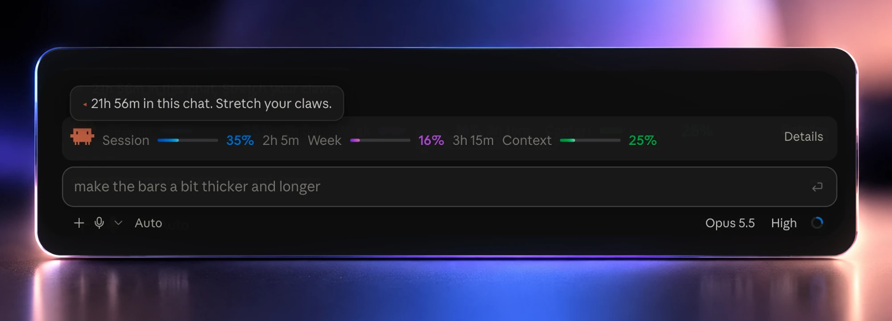

<div align="center">

# Clawd Meter

### Your Claude plan usage, right above the prompt.

A mod for [Claude Code](https://claude.com/claude-code) that keeps your session limit, weekly limit and context fill in view, so you never have to dig through settings to find out how much is left.

[](LICENSE)
[](https://github.com/Tanish-Dev/claude-usage-band/stargazers)


<br>



</div>

<br>

## Install

Type this at the prompt of a Claude Code terminal session:

```
/plugin install usage-band --marketplace Tanish-Dev/claude-usage-band
```

Answer `y` to add the marketplace, then pick the **user** scope. The band appears in that session straight away, and in every session you start afterwards, the desktop app's Code tab included.

## What you get

| | |
| --- | --- |
| **Session limit** | How much of the 5-hour window is used, and the time until it resets |
| **Weekly limit** | How much of the week is used, and the time until it resets |
| **Context** | How full the current conversation's context window is |
| **Colour that means something** | Blue, purple and green gradients at rest; a meter turns orange at 75% and red at 90% |
| **Pace** | Projects where each window will land: `on pace for ~57% by reset`, or `limit in ~1h 20m at this pace`. A meter turns orange early if your pace would hit the limit |
| **Limit warnings** | A toast when a limit crosses 75%, 90% and 95%, once per threshold per window |
| **Details view** | One row per meter with reset countdowns, token counts, chat length and cost at API rates |
| **Memory** | Your chosen view and the last limit reading carry over, so a new session shows numbers before its first reply |

## Meet Clawd

In the desktop app, a small pixel crab sits at the start of the band. It blinks, taps its feet, hops, and waves a claw now and then, and it squints once a limit passes 75%.

Hover it and it comments on your actual numbers:

> Only 15% of the session limit used. Plenty of room in the shell.
>
> The session limit resets in 24m. Fresh claws incoming.
>
> Context is 82% full (164k of 200k). A /compact would feel nice.

## Command

| Command | What it does |
| --- | --- |
| `/usage-band` | Prints a usage summary and brings a hidden band back |
| `/usage-band full` | Detailed view |
| `/usage-band compact` | One-line view |
| `/usage-band hide` | Hides the band |

## Terminal and desktop

The band works in both, with a few differences:

| | Desktop app | Terminal |
| --- | --- | --- |
| Meters, countdowns, warnings, command | Yes | Yes |
| Smooth gradient bars | Yes | Stepped, one shade per segment |
| Clawd and its hover bubble | Yes | No |

## Good to know

- **Subscription needed for limits.** The limits are read from Claude Code itself, so they need a Claude subscription (Pro, Max, Team). With an API key, the band shows context only.
- **Refresh rate.** Numbers refresh after each reply; countdowns tick every 30 seconds.
- **Private.** The mod makes no network requests. Nothing leaves your machine.
- **Early access.** Claude Code mods are an early-access API that may change between releases. Written against Claude Code 2.1.295.

## Develop

The whole mod is one file, [`hooks/register.tsx`](hooks/register.tsx).

```
claude plugin validate .
claude plugin test .
```

To run a working copy, start a session with `claude --plugin-dir <this folder>`.

## License

[MIT](LICENSE). An unofficial community mod, not affiliated with or endorsed by Anthropic.
